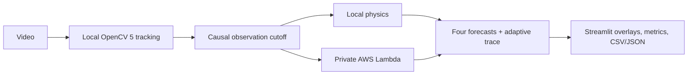

# PhysicsEye

PhysicsEye turns fixed-camera ball video into measured trajectories, causal physics forecasts, and reproducible benchmark results. It compares constant-velocity, refitted-deceleration, frozen-parameter, and adaptive-deceleration models locally or through a private AWS Lambda function.

The core idea is simple: **predict first, observe the outcome later, measure the error, then update the next prediction**. Every adaptive update is timestamped, bounded, and reconstructable; future observations are rejected from earlier prediction requests.

## What the MVP demonstrates

- OpenCV 5 automatic motion/circle tracking across ball colors, with orange-HSV and user-initialized ROI fallbacks.
- Four CPU-friendly trajectory models using identical causal observation histories.
- A persistent effective-deceleration estimate learned from earlier forecast residuals.
- A five-tab Streamlit dashboard with tracking status, overlays, model errors, adaptive traces, benchmark results, and exports.
- The same pure-Python physics engine running locally and in a private AWS Lambda, with numerical parity checks.
- Reproducible synthetic benchmarks and independently sourced real-video validation, including negative results.



Detailed design: [technical report](docs/TECHNICAL_REPORT.md) · [architecture](docs/ARCHITECTURE.md) · [evaluation](docs/EVALUATION.md) · [real-video validation](docs/REAL_VIDEO_VALIDATION.md)

## Verified headline results

- Held-out abrupt-change synthetic case: adaptive MAE `0.044910 px` versus frozen `0.265838 px`, an `83.106%` reduction over seven targets.
- Seven-scenario aggregate MAE: constant velocity `1.329688 px`, refitted `1.306162 px`, frozen `1.496590 px`, adaptive `1.358028 px`. Adaptive is not the aggregate winner.
- Real ROI reference checks: 31/31 visible references on-ball and 0/3 absent-target false positives across basketball, billiards, and disco-ball clips; center uncertainty is ±8–25 px.
- Real basketball Lambda replay: four models, three adaptive updates, maximum local/cloud difference `5.684e-14` at tolerance `1e-9`.

Synthetic results do not establish real-world accuracy. Real results remain image-space measurements affected by perspective, hand impulses, reflections, tracker error, and sparse manual annotations.

## Quick start

Python 3.10 was used for the verified setup on Linux x86_64.

```bash
python3 -m venv .venv
source .venv/bin/activate
python -m pip install -r requirements.txt -r requirements-dev.txt
python -c 'import cv2; print(cv2.__version__); assert cv2.__version__.startswith("5.")'
python scripts/generate_sample.py
python scripts/analyze_video.py --video examples/generated/constant_speed.mp4
pytest
```

The generator creates two 5-second, 30 FPS videos under `examples/generated/`, each with a same-named CSV containing the exact rendered center for every frame. It tries MP4 (`mp4v`) first, then AVI (`MJPG`), and accepts a codec only after OpenCV reopens and decodes the expected frame count and FPS.

The analyzer writes JSON and CSV tracks under `outputs/`. Each frame includes its zero-based frame number, time in seconds, detected center and contour area, plus a `valid` flag. Missing or rejected detections have null coordinates and area. Use `--fps NUMBER` only when a video's FPS metadata is unavailable.

## Physics prediction API

`predict_trajectory` accepts observations through an explicit cutoff and rejects later observations. All models use the same current position, direction, and speed estimate; only their deceleration parameter differs.

```bash
PYTHONPATH=src python - <<'PY'
import json
from physicseye.physics import predict_trajectory

with open("outputs/slowing_down.track.json", encoding="utf-8") as stream:
    track = json.load(stream)
cutoff = 2.0
history = [point for point in track if point["time_s"] <= cutoff]
print(json.dumps(predict_trajectory(history, cutoff, [0.25, 0.5, 1.0]), indent=2))
PY
```

Predictions remain in pixels, pixels/second, and pixels/second². The adaptive trace records when each forecast was issued, when its observation became available, its residual, and the resulting bounded parameter update.

## Reproduce the Phase 3 benchmark

```bash
env -u PYTHONPATH .venv/bin/python scripts/run_benchmark.py
```

The seeded CPU benchmark covers constant velocity, constant and changing deceleration, noise, pixel quantization, irregular timestamps, missing observations, and both generated videos through the OpenCV 5 tracker. It writes:

- `outputs/evaluation.csv`: every prediction with cutoff, target, ground truth, prediction, and error
- `outputs/evaluation_summary.csv`: scenario/model MAE, median, RMSE, endpoint, parameter, improvement, and failure metrics
- `outputs/evaluation_by_horizon.csv`: metrics for 0.25, 0.5, and 1.0-second horizons
- `outputs/evaluation.json`: full machine-readable benchmark and causal audit records
- `outputs/adaptive_traces.json`: adaptive updates and skipped-update reasons
- `docs/EVALUATION.md`: concise benchmark report including negative results

The bundled videos are synthetic fixtures. Their tracker measurements are evaluated against separately loaded rendered-center ground truth; these results do not establish accuracy on independently recorded real video.

## Phase 6 real-video validation

Three permitted Pexels clips exposed the original HSV detector's failure: 0/32 manually checked positions were on the ball. A user-selected ROI template mode now tracks appearance within a motion- and size-constrained local search and emits invalid observations when confidence is insufficient. On 34 independent visible/absent reference frames, all three clips achieved 100% annotated on-ball rate, zero annotated false positives, and center MAE of 16.121 px (basketball), 18.143 px (billiards), and 3.681 px (disco). These sparse checks validate target identity, not subpixel or calibrated physical accuracy.

See [real-video validation](docs/REAL_VIDEO_VALIDATION.md) for sources, license restrictions, authorized download commands, before/after metrics, all four causal model results, annotation uncertainty, and real Lambda parity evidence. Downloaded originals remain under the Git-ignored `examples/real/` directory. After downloading them, reproduce the measurement with:

```bash
env -u PYTHONPATH .venv/bin/python scripts/validate_real_videos.py
```

## Run the dashboard

From the repository root:

```bash
env -u PYTHONPATH .venv/bin/streamlit run app.py
```

The default Streamlit flow is upload, automatic analysis, synchronized side-by-side playback, and MP4 download. The left panel is the original frame; the right panel shows the automatically selected ball, tracked history, dashed causal forecast, endpoint, direction arrow, image-coordinate angle, horizon, and tracking status. MP4, AVI, and MOV inputs are accepted up to 100 MB, 60 seconds, and 2.1 megapixels per frame (1920x1080). Frames are processed sequentially at a working resolution no larger than 1280x720, and the compressed result—not decoded frames—is retained. A clean 512 MB container completed the tested 1080p clip; 4K is rejected before decoding and should be resized first.

**Advanced Options** retains **Orange HSV** for generated samples and **Select target ROI** when automatic appearance/continuity checks cannot isolate the intended ball. Manual cutoffs, horizons, model comparison, and AWS parity remain available without being required by the default flow. The other dashboard tabs continue to expose all four models, later observations labeled as evaluation-only, benchmark data, adaptive updates, skipped-update reasons, and JSON/CSV exports.

The Benchmark Results tab reads the existing Phase 3 artifact at `outputs/evaluation.json`; run `env -u PYTHONPATH .venv/bin/python scripts/run_benchmark.py` if it is missing. The dashboard reports regressions as well as improvements and does not claim that adaptive prediction is always best.

`LOCAL` is the default execution mode. `AWS` keeps OpenCV tracking local and sends only the causal observation prefix to the configured Lambda. It has no silent fallback and displays local/cloud parity and real invocation metadata. See [AWS deployment](docs/AWS_DEPLOYMENT.md) for the request contract, least-privilege IAM setup, deployment, invocation, evidence, and cleanup commands. Cloud deployment and verification require explicit authorization and valid AWS credentials.

Predictions remain causal: the selected cutoff determines the observation prefix sent to the physics engine. Later tracker points are joined only after prediction for evaluation and are visually labeled. Pixel-space measurements are not calibrated physical units. The real clips include perspective, hand impulses, occlusion, and reflections; their numerical adaptive gains do not establish calibrated physical accuracy.

## Tracking constraints

Automatic mode combines frame differencing, a small MOG2 foreground model, circularity/extent checks, and three-frame temporal consistency before it initializes the existing appearance tracker. Confidence, size, and displacement gates reject uncertain matches; after repeated failures it searches globally again. Missing and occluded positions stay invalid rather than being interpolated. It works best with one visually distinct moving ball and a fixed or slowly moving camera; reflections, cuts, camera motion, similarly shaped moving objects, and strong scale changes remain failure modes.

Orange-HSV mode still expects one orange ball, a dark or plain background, fixed camera, even lighting, and little occlusion. It thresholds HSV values from `(5, 100, 100)` through `(25, 255, 255)`, removes small mask noise with 5x5 morphological operations, accepts contour areas from 100 pixels² through 10% of the frame, and rejects center jumps over 50 pixels per elapsed frame.

ROI mode is the manual fallback for other appearances. Select a tight ball box on a clear frame. It uses normalized grayscale template matching at five nearby scales, local motion continuity, size limits, and a confidence gate. It does not fabricate positions during a failed match. It assumes a roughly fixed camera and can still fail under long occlusion, extreme scale/appearance change, or a similar nearby object.

This is automatic processing of uploaded recordings, not real-time camera inference. Forecasts use the existing straight-motion/deceleration model and do not predict bounces or collisions.

If your shell exports a ROS `PYTHONPATH`, prefix the Python and pytest commands with `env -u PYTHONPATH` to keep the virtual environment isolated.

## AWS deployment

AWS mode uses a private Lambda and the standard boto3 credential chain. Video remains local; only timestamped observations through the cutoff are sent. The handler validates schema and request limits, and the dashboard displays errors without silently substituting local output.

Follow [docs/AWS_DEPLOYMENT.md](docs/AWS_DEPLOYMENT.md) for least-privilege setup, packaging, invocation, parity verification, and cleanup. Cloud resources may incur charges until removed.

## Submission and documentation

- [Technical report](docs/TECHNICAL_REPORT.md)
- [Submission checklist and Devpost copy](docs/SUBMISSION_CHECKLIST.md)
- [Maximum-five-minute demo script](docs/DEMO_SCRIPT.md)
- [AWS deployment](docs/AWS_DEPLOYMENT.md)
- [Synthetic evaluation](docs/EVALUATION.md)
- [Real-video validation and licensed-source instructions](docs/REAL_VIDEO_VALIDATION.md)

The repository prepares the technical submission materials but does not claim that a demo video has been recorded or that a Devpost entry has been submitted. Those manual steps are tracked explicitly in the submission checklist.

