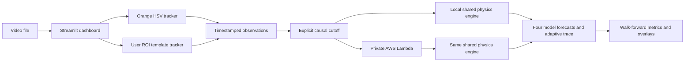

# PhysicsEye architecture

OpenCV 5 decoding and tracking stay on the local computer. The default HSV mode preserves the deterministic synthetic benchmark. ROI mode uses a user-selected initialization box, grayscale normalized template matching, bounded scale changes, local motion-constrained search, and a confidence gate. Failed matches remain invalid observations with no interpolated position.

Only timestamped observations through the selected cutoff are sent to the private Lambda. Local and cloud execution import the same dependency-free physics module. Later observations or independent manual annotations are joined after prediction for evaluation.

No public endpoint, video upload to AWS, database, object storage, neural model, or training service is used.
