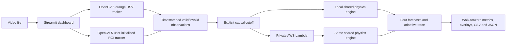

# PhysicsEye technical report

## Project overview

PhysicsEye is a CPU-friendly vision system that turns fixed-camera ball video into tracked image-space trajectories, causal future-position forecasts, and an auditable adaptive deceleration estimate. It combines OpenCV 5 perception with four interpretable motion models and can execute the prediction workload in a private AWS Lambda function.

The real-world problem is not merely locating an object in the current frame. Education, laboratory measurement, process monitoring, sports prototyping, and robotics experiments also need a forecast, a measured error, and a clear account of why the model changed. PhysicsEye therefore follows a chronological loop:

1. observe positions from video;
2. predict future positions using only observations available at a declared cutoff;
3. reveal a later observation and measure the error;
4. update one bounded physical parameter only after that outcome is available;
5. expose the forecast, error, parameter update, and failure state in the dashboard and exports.

The intended users are students, engineers, and developers studying simple planar motion. The MVP is not a safety controller, generalized object detector, calibrated metrology system, or autonomous robot.

## System architecture



OpenCV decoding and tracking remain local. Only observations whose timestamps are at or before the selected cutoff are sent to Lambda. The local and cloud paths import the same dependency-free physics module. Future tracker observations or manual references are joined only after prediction for evaluation. There is no public endpoint, raw-video cloud upload, database, object store, neural model, or training service.

The standalone diagram and trust boundary are documented in [ARCHITECTURE.md](ARCHITECTURE.md).

## OpenCV 5 implementation

The verified environment uses `opencv-python-headless==5.0.0.93`, and the application rejects a runtime whose `cv2.__version__` does not start with `5.`.

Two tracking modes share the same observation shape:

- **Orange HSV:** `VideoCapture` decodes frames; BGR is converted to HSV; `inRange` applies the fixed orange bounds `(5,100,100)`–`(25,255,255)`; morphological open/close removes mask noise; contours are filtered by area; moments provide the center; and implausible jumps are rejected. This deterministic mode is used by the generated fixtures.
- **User-initialized ROI:** the user selects a bounding box on a decoded frame. The patch is converted to blurred grayscale and matched with `TM_CCOEFF_NORMED` inside a motion-constrained local region at five nearby scales. Confidence, predicted-position, displacement, and size checks reject background switches. UHD search is downscaled to a maximum dimension of 960 pixels and mapped back to source coordinates.

Invalid tracking produces null coordinates. The tracker does not interpolate a position through an occlusion. ROI observations additionally expose the bounding box, status, and a matching score used as a diagnostic confidence value, not a calibrated probability.

The dashboard limits uploaded MP4, AVI, or MOV files to 100 MB, 60 seconds, and 2.1 megapixels per frame (1920x1080), writes bytes under a generated temporary name rather than trusting the client path, validates metadata, and reports tracking failures. The resolution guard was added after a 4K flow reached about 910 MB in a constrained Linux container while an equivalent 1080p flow peaked near 217 MB.

## Physics prediction methods

All four models implement one interface and receive the same chronological observation prefix, current position, direction, estimated speed, cutoff, and horizons:

1. **Constant velocity:** uses `d = 0` and projects the current velocity.
2. **Refitted deceleration:** independently estimates a nonnegative effective deceleration from the most recent 0.75 seconds at each cutoff.
3. **Frozen deceleration:** retains the initial fitted value; this ablation isolates the value of later updates.
4. **Adaptive deceleration:** carries an effective deceleration reconstructed from earlier prediction errors.

Position and speed are estimated with least-squares slopes over recent valid timestamps. The straight-line distance model is

```text
s(h) = v h - 0.5 d h²
```

until the stop time `v/d`; later forecasts retain the stopping distance `v²/(2d)`. Results stay in pixels, pixels/second, and pixels/second². Without spatial calibration, `d` is an image-space effective deceleration, not a friction coefficient.

## Adaptive parameter learning

The adaptive model uses a fixed feedback horizon of 0.25 seconds and `alpha = 0.25`. For a prediction issued at an earlier cutoff, it measures the signed along-motion residual only after the target observation becomes available:

```text
e = predicted displacement - observed displacement
d_candidate = clip(d + 2e/h², 0, v/h)
d_next = (1-alpha)d + alpha*d_candidate
```

The update is skipped and logged if feedback is too late, speed is too small, the predicted stop lies inside the feedback interval, or motion direction becomes ambiguous. State includes the initial/current parameter, update count, timestamped trace, and skipped-update reasons. Replaying identical ordered observations produces identical state.

This differs from ordinary trajectory fitting: the refitted model estimates a parameter independently at each cutoff, whereas the adaptive model changes persistent state from an error belonging to a prediction that has already matured.

## Causality and leakage prevention

The prediction API rejects duplicate/non-monotonic timestamps and any observation later than `cutoff_time_s`. The evaluator uses strict walk-forward ordering:

1. slice history to `time <= cutoff`;
2. forecast all models at identical horizons;
3. store the prediction and model state;
4. reveal the later target for scoring;
5. allow that now-historical outcome to affect only a later cutoff.

Automated tests modify future observations and verify that an earlier prediction is unchanged. Evaluation artifacts retain cutoff, target, maximum history time, adaptive update availability, sample counts, and failures so the ordering can be audited.

## AWS Lambda architecture

The private `physicseye-predict` function runs Python 3.13 with 128 MB memory and a 10-second timeout in `ap-southeast-1`. A small ZIP contains only `lambda_handler.py` and the shared pure-Python physics package; OpenCV and NumPy are not needed in Lambda.

The handler accepts `{observations, cutoff_time_s, horizons_s}`, rejects unknown/missing fields, and limits requests to 1 MB, 5,000 observations, and 20 horizons. It returns four forecasts, model parameters, adaptive trace, warnings, schema version, and `engine=aws_lambda`.

The dashboard invokes Lambda synchronously through boto3's standard credential chain. Errors are visible and never relabeled as AWS after a local fallback. Deployment uses a dedicated execution role with `AWSLambdaBasicExecutionRole`; the dashboard caller can be limited to `lambda:InvokeFunction` on this function. There are no keys in source control and no public API Gateway.

The final real-video verification used basketball ROI observations through 4.8 seconds. Request ID `0eb148be-b607-46d2-b6b1-ac4b807bd318` returned all four models and three updates. Local/cloud maximum numeric difference was `5.684341886080802e-14` at tolerance `1e-9`, with no schema mismatch. Invocation latency was 462.983 ms and reported Lambda duration was 12.25 ms in that single trial; these values are evidence, not a latency benchmark.

Deployment, invocation, least-privilege guidance, evidence capture, and cleanup are in [AWS_DEPLOYMENT.md](AWS_DEPLOYMENT.md).

## Evaluation method

The deterministic benchmark fixes seed `20261021`, horizons 0.25/0.5/1.0 seconds, adaptive alpha 0.25, cutoffs, and the 10% acceptance threshold before evaluation. It covers ideal constant velocity, quantized constant deceleration, abrupt and gradual deceleration changes, Gaussian noise, irregular timestamps, missing observations, and two generated videos processed through OpenCV 5. Synthetic truth remains separate from tracker measurements.

### Aggregate four-model benchmark

Across seven scenarios, every model has 231 matched predictions:

| Model | MAE px | RMSE px | 1.0 s endpoint px |
|---|---:|---:|---:|
| Constant velocity | 1.329688 | 2.168196 | 2.659600 |
| Refitted deceleration | 1.306162 | 2.242586 | 2.427702 |
| Frozen deceleration | 1.496590 | 2.417208 | 2.963820 |
| Adaptive deceleration | 1.358028 | 2.348350 | 2.630440 |

The refitted model has the lowest aggregate MAE; the adaptive model is not presented as universally best. Adaptive aggregate MAE is 9.259% better than frozen but 3.971% worse than refitted.

### Adaptive acceptance case

In the predeclared held-out post-change window of the abrupt-deceleration scenario, frozen MAE is `0.265838 px` and adaptive MAE is `0.044910 px` over seven targets. The reduction is `83.106%`, passing the required >=10% criterion. This is a controlled synthetic result, not evidence of real-world accuracy.

### Positive and negative synthetic results

- Constant velocity is exact in the ideal control.
- Adaptive improves over frozen by 69.284% across the full abrupt-change scenario and by 14.068% with irregular, missing, noisy observations.
- Adaptive is 27.097% worse than frozen on gradual noisy motion.
- On generated OpenCV fixtures it is 170.806% worse on constant speed and 17.207% worse on slowing motion than frozen.
- The generated-video tracker itself has center MAE `0.035545 px` and `0.032061 px` against exact rendered centers.

Full scenario, horizon, parameter, failure, and update-trace results are in [EVALUATION.md](EVALUATION.md) and the reproducible machine-readable files written under Git-ignored `outputs/`.

## Real-world validation

Three permitted Pexels UHD clips test a basketball, billiard ball, and mirrored disco ball. The original HSV tracker followed background objects or rejected the target: 0/32 manually checked detections were on-ball. ROI tracking was then evaluated against 31 visible center references and three absent-target references:

| Video | Valid visible coverage | On-ball reference rate | Annotated false positives | Center MAE px |
|---|---:|---:|---:|---:|
| Basketball | 67/67 (100%) | 7/7 (100%) | 0/3 | 16.121 |
| Billiards | 322/322 (100%) | 12/12 (100%) | 0 | 18.143 |
| Disco | 171/171 (100%) | 12/12 (100%) | 0 | 3.681 |

These sparse annotations validate target identity, not subpixel precision. Their center uncertainty is ±8–25 px; the disco MAE is below its annotation uncertainty.

Strict walk-forward prediction produced:

| Video | n/model | Horizon | CV / refit / frozen / adaptive MAE px | Adaptive gain vs frozen |
|---|---:|---|---|---:|
| Basketball | 4 | 0.40 s | 29.877 / 29.877 / 29.877 / 29.877 | 0% |
| Billiards | 10 | 1.16–1.20 s | 1288.730 / 1055.900 / 1288.730 / 838.961 | 34.900% |
| Disco | 9 | 0.60–0.64 s | 18.801 / 15.184 / 15.527 / 13.657 | 12.044% |

The numerical gains do not prove a learned physical property. Basketball perspective produces apparent acceleration; hands repeatedly redirect the billiard ball, leaving adaptive error above 800 px; and the disco model difference is smaller than annotation uncertainty. Detailed provenance, authorized download steps, runtime, failures, RMSE, annotations, and AWS parity are in [REAL_VIDEO_VALIDATION.md](REAL_VIDEO_VALIDATION.md).

## User experience and reproducibility

The five-tab Streamlit dashboard provides sample/upload input, HSV or ROI initialization, tracking diagnostics, cutoff/horizon controls, LOCAL/AWS execution, cutoff-anchored overlays, model tables, error charts, adaptive traces, benchmark results, and CSV/JSON downloads. It labels later points as evaluation-only and reports negative adaptive results.

The repository pins five dependencies, generates its own synthetic media, validates codecs by reopening them, offers deterministic benchmark scripts, documents third-party real-video download separately, and passed the full suite in both the working and a fresh virtual environment. Reproduction starts in [README.md](../README.md).

## Security, privacy, and responsible use

- Credentials stay in the standard AWS credential chain; `.env`, `.aws/`, key files, archives, outputs, and videos are ignored.
- The Lambda is private and receives causal numeric observations rather than video.
- File suffix, size, duration, decode metadata, request schema, request size, timestamps, and finite numeric values are validated.
- No shell command is constructed from uploaded filenames, and client paths are not reused.
- The system processes one selected object and does not identify people. It should not be used for covert surveillance, safety-critical control, or claims about material properties.
- Synthetic measurements are labeled synthetic; real annotations, uncertainties, failed baselines, model regressions, and incompatible dynamics are retained.
- Pexels originals are credited and excluded from Git. Submission media must comply with the Pexels license and Devpost's submitted-material license.

## Open-source references and licensing

The project implementation was written directly; external projects informed scope and validation rather than supplying copied code.

- [trflorian/ball-tracking-live-plot](https://github.com/trflorian/ball-tracking-live-plot), MIT: reference for classical masking and trajectory visualization.
- [vincent-leguen/PhyDNet](https://github.com/vincent-leguen/PhyDNet), MIT: research reference for physics-structured prediction; its neural model was not adopted.
- [MehakArora/Ball_Tracking](https://github.com/MehakArora/Ball_Tracking), [NattyBumppo/Ball-Tracking](https://github.com/NattyBumppo/Ball-Tracking), [turman17/tennis-ball-detection-and-tracking](https://github.com/turman17/tennis-ball-detection-and-tracking), and [ccyydd/PhysMind](https://github.com/ccyydd/PhysMind) had no repository license found at inspection time; they were treated as reference-only and no code or assets were copied.
- Real validation uses three Pexels clips under the [Pexels license](https://www.pexels.com/license/). Originals are not redistributed in this repository.

Dependency versions are pinned in `requirements.txt` and `requirements-dev.txt`. This report does not assign a license to PhysicsEye; repository licensing, if desired, is an owner decision.

## Technical limitations

- Outputs are 2D pixel-space measurements; there is no camera calibration or depth.
- Constant straight-line deceleration does not model impacts, bounces, turns, slopes, perspective, or hand impulses.
- Tracking assumes a roughly fixed camera and one selected target. HSV is scene-specific; ROI matching can fail under long occlusion, large scale/appearance changes, blur, or a similar nearby object.
- Matching score is not a probability. Manual real-video references are sparse and uncertain.
- Video time uses `frame/fps`; variable-frame-rate media may require transcoding.
- Adaptation can absorb tracking bias as if it were physics and may be worse than simple baselines.
- The dashboard accepts prerecorded files only. A local authenticated AWS profile is needed for cloud mode; there is no hosted public dashboard.
- Reported latency is host- and invocation-specific, not a cost or throughput study.

## Future improvements

After submission, justified extensions include planar camera calibration, a held-out raw-versus-Kalman smoothing study, stronger appearance descriptors for longer occlusions, variable-frame-rate timestamps, bounce/collision models with separate evaluation, webcam streaming, and multiple-object identity. Heavy neural detectors, 3D reconstruction, and agent frameworks should be added only if a measured use case warrants their cost and new validation burden.
